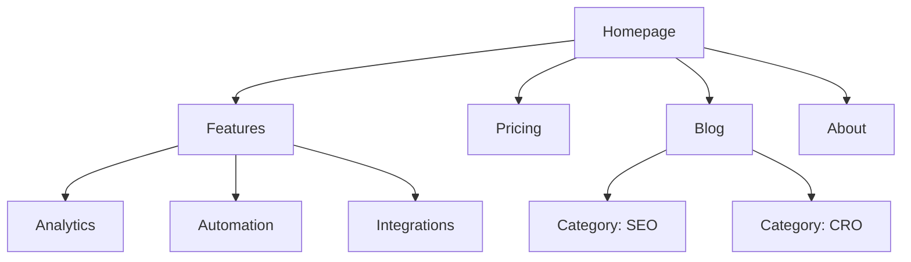

# Gabarits et tableaux — site-architecture

Détail appelé depuis `SKILL.md` : les gabarits complets (arbre ASCII, sitemap Mermaid,
modèle hub-and-spoke, footer), les tableaux complets (types de site, profondeur, patterns
d'URL, types de lien) et l'exemple de tableau URL map. Rien ici n'est nouveau — c'est le même
contenu que celui qui vivait dans le texte principal avant découpe, déplacé pour que
`SKILL.md` reste sous la limite de signes de l'éditeur.

## Table des matières

1. [Site types (tableau complet)](#site-types-tableau-complet)
2. [Profondeur par approche (tableau complet)](#profondeur-par-approche-tableau-complet)
3. [Footer (gabarit)](#footer-gabarit)
4. [Arbre ASCII (gabarit)](#arbre-ascii-gabarit)
5. [Sitemap visuel (gabarit Mermaid)](#sitemap-visuel-gabarit-mermaid)
6. [Modèle hub-and-spoke (gabarit)](#modèle-hub-and-spoke-gabarit)
7. [URL par type de page (tableau complet)](#url-par-type-de-page-tableau-complet)
8. [Types de lien (tableau complet)](#types-de-lien-tableau-complet)
9. [URL map (exemple de tableau)](#url-map-exemple-de-tableau)

## Site types (tableau complet)

| Site Type | Typical Depth | Key Sections |
|-----------|--------------|--------------|
| SaaS marketing | 2–3 levels | Home, Features, Pricing, Blog, Docs |
| Content/blog | 2–3 levels | Home, Blog, Categories, About |
| E-commerce | 3–4 levels | Home, Categories, Products, Cart |
| Documentation | 3–4 levels | Home, Guides, API Reference |
| Hybrid SaaS + content | 3–4 levels | Home, Product, Blog, Resources, Docs |
| Small business | 1–2 levels | Home, Services, About, Contact |

## Profondeur par approche (tableau complet)

| Approach | Best For |
|----------|----------|
| Flat (2 levels) | Small sites, portfolios |
| Moderate (3 levels) | Most SaaS, content sites — best balance |
| Deep (4+ levels) | E-commerce, large docs — risks burying content |

## Footer (gabarit)

Group into columns:
- **Product**: Features, Pricing, Integrations, Changelog
- **Resources**: Blog, Case Studies, Templates, Docs
- **Company**: About, Careers, Contact, Press
- **Legal**: Privacy, Terms, Security

## Arbre ASCII (gabarit)

Format à reproduire pour la hiérarchie de pages, avec l'URL de chaque nœud :

```
Homepage (/)
├── Features (/features)
│   ├── Analytics (/features/analytics)
│   ├── Automation (/features/automation)
│   └── Integrations (/features/integrations)
├── Pricing (/pricing)
├── Blog (/blog)
│   ├── [Category: SEO] (/blog/category/seo)
│   └── [Category: CRO] (/blog/category/cro)
├── Resources (/resources)
│   ├── Case Studies (/resources/case-studies)
│   └── Templates (/resources/templates)
├── Docs (/docs)
│   ├── Getting Started (/docs/getting-started)
│   └── API Reference (/docs/api)
└── About (/about)
    └── Careers (/about/careers)
```

## Sitemap visuel (gabarit Mermaid)



Use `subgraph` to denote navigation zones (Header Nav vs. Footer Nav).

## Modèle hub-and-spoke (gabarit)

```
Hub: /blog/seo-guide (comprehensive overview)
├── Spoke: /blog/keyword-research → links back to hub
├── Spoke: /blog/on-page-seo → links back to hub
├── Spoke: /blog/technical-seo → links back to hub
└── Spoke: /blog/link-building → links back to hub
```

Each spoke links to the hub and to sibling spokes where relevant.

## URL par type de page (tableau complet)

| Page Type | Pattern | Example |
|-----------|---------|---------|
| Feature page | `/features/{name}` | `/features/analytics` |
| Blog post | `/blog/{slug}` | `/blog/seo-guide` |
| Blog category | `/blog/category/{slug}` | `/blog/category/seo` |
| Case study | `/customers/{slug}` | `/customers/acme-corp` |
| Documentation | `/docs/{section}/{page}` | `/docs/api/auth` |
| Comparison | `/vs/{competitor}` | `/vs/hubspot` |
| Integration | `/integrations/{name}` | `/integrations/slack` |
| Template | `/templates/{slug}` | `/templates/marketing-plan` |
| Legal | `/{page}` | `/privacy`, `/terms` |

## Types de lien (tableau complet)

| Type | Purpose | Example |
|------|---------|---------|
| Navigational | Move between sections | Header, footer, sidebar |
| Contextual | Related content within text | "Learn more about [analytics](/features/analytics)" |
| Hub-and-spoke | Connect cluster content to hub | Blog posts linking to pillar page |
| Cross-section | Connect across site sections | Feature page → related case study |

## URL map (exemple de tableau)

| Page | URL | Parent | Nav Location | Priority |
|------|-----|--------|-------------|----------|
| Homepage | `/` | — | Header logo | High |
| Features | `/features` | Homepage | Header | High |
| Analytics | `/features/analytics` | Features | Header dropdown | Medium |
| Pricing | `/pricing` | Homepage | Header | High |
| Blog | `/blog` | Homepage | Header | Medium |
